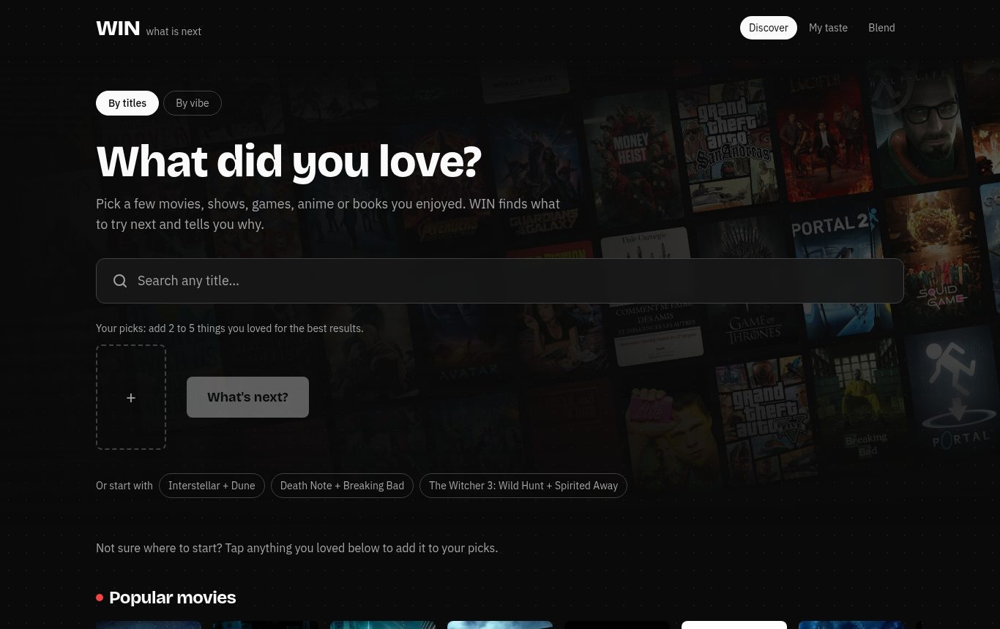
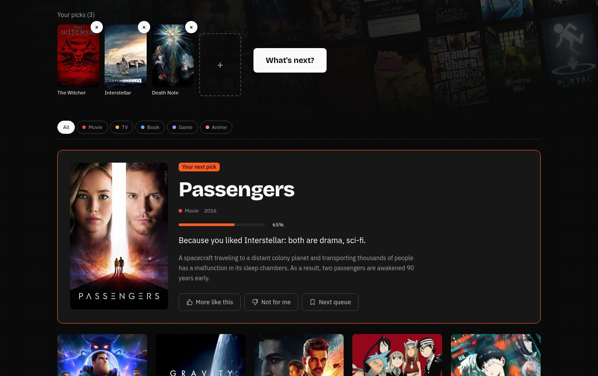
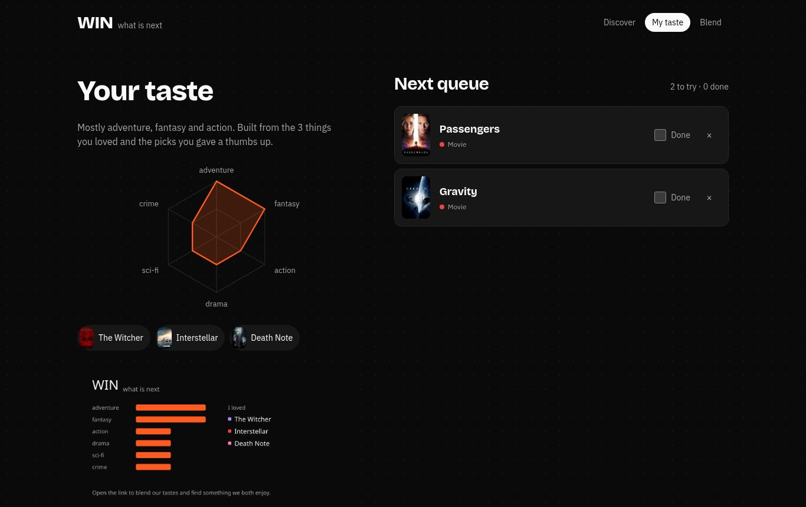
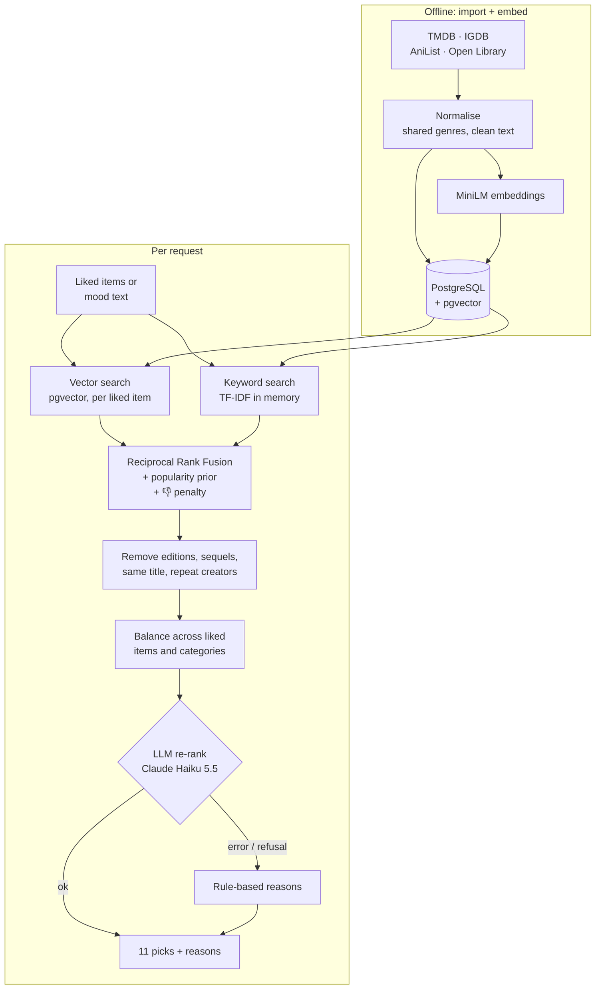

# WIN — What Is Next

[](https://github.com/49mg/WIN/actions/workflows/ci.yml)

**Tell WIN a few things you loved — a movie, a show, a game, an anime, a book — and it tells you what to try next, from any of those categories, with a one-line reason for every pick.**



WIN is a cross-category recommender built end to end: data pipelines from four public APIs, an evaluated retrieval engine (embeddings + keyword search with rank fusion), an LLM re-ranking step that was measured before it was shipped, a live A/B test, and a Next.js front end.

| | |
|---|---|
|  |  |
| **Picks with reasons.** "Like Interstellar, it is a thoughtful sci-fi drama…" | **Your taste, your queue,** and a taste card to share |

## What it does

- **Pick what you loved** from 11,721 titles across 5 categories, search with poster results, or start from popular rows.
- **Get 11 picks across categories**, each with a reason. Picks show at once; an AI-refined list replaces them a few seconds later.
- **Vibe mode:** describe a mood ("cozy and a bit sad, for a rainy night") instead of titles.
- **Live feedback:** 👍 / 👎 reshape the list below the card you voted on.
- **Next queue, taste profile, taste card**, and **Blend**: send a link, get picks you'd both enjoy.
- **Anonymous accounts** (no sign-up), data saved server-side; a read-only share code is used for links.

## How it works



1. **Retrieve.** For each liked item, find its nearest neighbours (pgvector) and its best keyword matches (TF-IDF over genres, tags and descriptions). Each candidate is scored against its *closest* liked item, not an average — so "Death Note + Dune" gets picks for both, not a blur of the two.
2. **Fuse.** Combine both rankings with Reciprocal Rank Fusion, plus a popularity prior (weight 0.3) and a penalty for anything close to a 👎.
3. **Clean up.** Drop other editions and direct sequels of what you listed (cosine > 0.68, measured), the same title in another medium (the *Dune* movie when you listed the book), and more than one pick per author/studio. Balance the list across your liked items and categories.
4. **Re-rank.** Claude Haiku 5.5 orders the 30 best candidates and writes the reasons. It can only answer with candidate indexes (structured output), so it can't invent titles. On any failure WIN keeps its own picks and rule-based reasons.

## Results

Every engine decision was tested offline on [MovieLens](https://grouplens.org/datasets/movielens/) first: real users, a time-based split (predict what each user liked *later*), and the same evaluation code for every model ([`evaluate.py`](backend/app/recsys/evaluate.py), notebooks in [`notebooks/`](notebooks/)).

**1 · Which model?** (589 test users, full rating history)

| Model | NDCG@10 | |
|---|---|---|
| ALS collaborative filtering | **0.102** | best, but needs users who rated items in *every* category — a new cross-category app has none |
| MiniLM embeddings + popularity | 0.082 | ✔ chosen: works from descriptions alone, across categories |
| Popularity baseline | 0.079 | |
| Embeddings alone | 0.006 | recommend obscure titles nobody watches |

**2 · Hybrid search** (581 users, last 5 likes each, as in the app)

| Retrieval | Recall@30 | NDCG@10 |
|---|---|---|
| Vector only | 0.090 | 0.062 |
| Keyword only (TF-IDF) | 0.094 | 0.062 |
| **Hybrid (RRF)** | **0.111 (+24%)** | **0.070 (+14%)** |

Both gains are significant (paired bootstrap, 95% CI). A first run made hybrid look *worse* because it fused the weakest keyword setting — comparing methods at equal settings fixed that.

**3 · Does the LLM help?** (100 users, ~200 Claude calls, under $1)

| Method | Recall@10 | NDCG@10 | |
|---|---|---|---|
| Engine | 0.032 | 0.055 | |
| Engine + LLM re-ranking | **0.046 (+43%)** | 0.046 | recall gain significant; NDCG change is noise |
| LLM alone | 0.046 | 0.062 | not significant, and 11.5% of its titles aren't in the catalog |

So WIN uses the LLM as a **re-ranker** over retrieved candidates, not as the recommender. Live, the A/B test (30% of new users get the engine only) compares 👍 / queue rates per card on the `/stats` page.

Other measured choices: popularity weight 0.3 (84% of the best accuracy with 1.7× the catalog coverage of 0.5), closest-liked-item scoring instead of averaging, keeping the title in the embedded text (removing it cost 19% NDCG).

## Tech stack

| Layer | Tools |
|---|---|
| Data | TMDB, IGDB (Twitch), AniList, Open Library importers · PostgreSQL 17 + **pgvector** |
| ML / search | **sentence-transformers** (all-MiniLM-L6-v2) · scikit-learn TF-IDF · Reciprocal Rank Fusion · implicit (ALS, for evaluation) |
| LLM | **Claude Haiku 5.5** via the Anthropic SDK, structured output, fallback + pause on errors; cost-protected by a daily call cap, a per-user/IP rate limit and server-side A/B arm checks |
| API | FastAPI · Pydantic · psycopg 3 |
| Front end | Next.js 15 · React 19 · Tailwind CSS 4 · server-rendered taste-card images (next/og) |
| Evaluation | pandas · NumPy · Jupyter · paired bootstrap · Wilson intervals for the live A/B test |
| Quality | ruff · TypeScript |
| Ops | Docker Compose · uv |

## Run it locally

```bash
cp .env.example .env            # add free TMDB + IGDB keys; ANTHROPIC_API_KEY is optional
docker compose up -d --build    # database :5433, API :8000, web app :3000

cd backend && uv sync
uv run python -m app.ingest anilist --limit 2000       # anime, no key needed
uv run python -m app.ingest openlibrary --limit 3000   # books, no key needed (~10 min)
uv run python -m app.ingest tmdb --limit 5000          # movies + TV
uv run python -m app.ingest igdb --limit 3000          # games
uv run python -m app.embed                             # vectors for new or changed items
```

Open http://localhost:3000. Without `ANTHROPIC_API_KEY`, WIN runs on its own engine and rule-based reasons.

**Experiments**

```bash
cd backend
uv run python -m app.recsys.compare [--tmdb]      # model comparison
uv run python -m app.recsys.hybrid_eval           # hybrid search experiment
uv run python -m app.recsys.llm_eval --users 100  # LLM experiment (needs ANTHROPIC_API_KEY)
```

## Project layout

```
backend/app/
  ingest/       importers (one module per source) + shared genre mapping
  embed.py      embedding pipeline        keyword.py   TF-IDF index
  recommend.py  the engine (retrieve, fuse, filter, balance, explain)
  rerank.py     LLM re-ranking            users.py / share.py / metrics.py   accounts, Blend, A/B metrics
  recsys/       offline evaluation, model comparison, hybrid + LLM experiments
frontend/       Next.js app and components
notebooks/      EDA, model comparison, every experiment above with its results
```

## Data sources

Movies and TV from [TMDB](https://www.themoviedb.org), games from [IGDB](https://www.igdb.com), anime from [AniList](https://anilist.co), books from [Open Library](https://openlibrary.org); offline evaluation on [MovieLens](https://grouplens.org/datasets/movielens/) (GroupLens Research). This product uses the TMDB API but is not endorsed or certified by TMDB.
